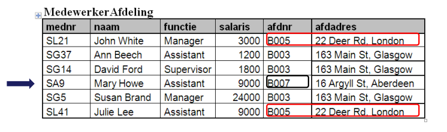
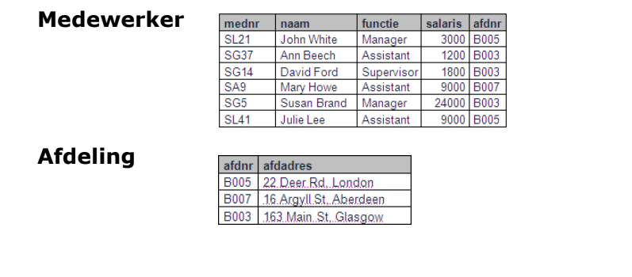
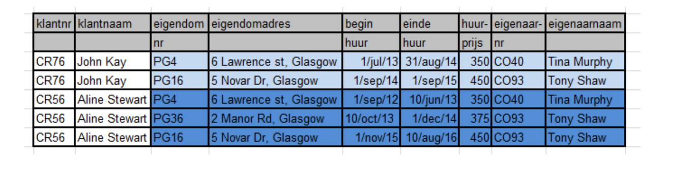
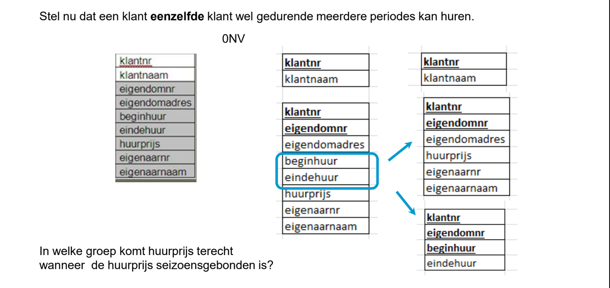
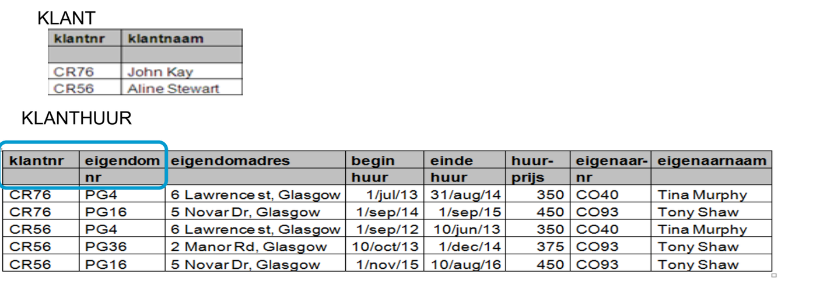
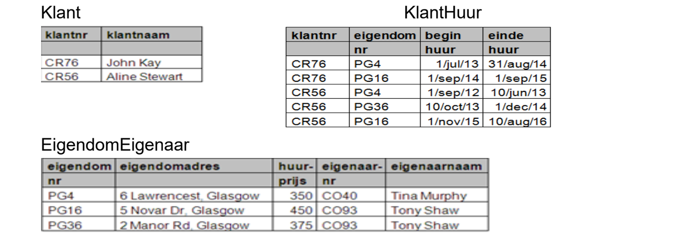
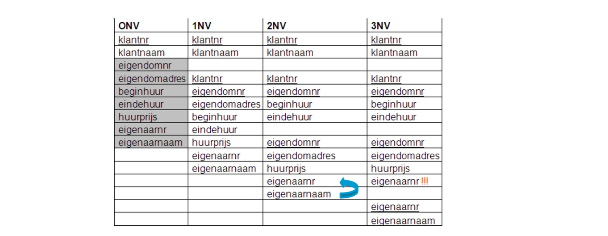
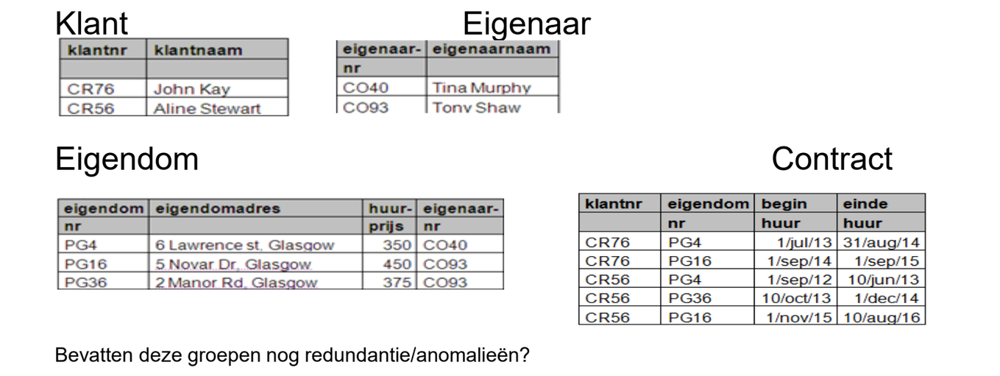

# normaliseren

## defenitie
- Normalisatie gebeurd door een groep gegevens op te splitsen in meerdere groepen gegevens zonder gegevensverlies 
## nadelen

- meer opslagruimte nodig 
- kans op inconstitenties
- meer werk bij aanpassingen

## anomalieen

### defenitie
- onregelmatigheden bij het gebruik en onderhoud van gegevens
### verschillende soorten

| soort  | defenitie                                                                                                                                                        |
| ------ | ---------------------------------------------------------------------------------------------------------------------------------------------------------------- |
| INSERT | Informatie over een nieuwe afdeling komt maar in het informatiesysteem wanneer de eerste medewerker uit die afdeling wordt opgenomen in MedewerkerAfdeling |
| UPDATE | Heeft met de redundante informatie te maken. Wanneer een afdeling een nieuw adres krijgt, moeten mogelijk meerdere rijen aangepast worden.                    |
| DELETE | Als Mary Howe het bedrijf verlaat, is er geen informatie meer terug te vinden over afdeling B007.                                                             |

### hoe wegwerken
> medewerker opsplitsen in een aparte database adhv normalisatie

 functionele afhakelijkheid beschrijft de relatie tussen attributen binnen een entiteit

Wanneer **A** en **B** attributen zijn uit een entiteitstype **R** dan zeggen we dat
**B** functioneel afhankelijk is van **A**, wanneer één waarde van attribuut **A** exact één waarde van attribuut B bepaalt.
notatie: **A** -> **B** ^c3525e

---
# normalisatie praktijk

## 1nv
 herhalende groepen gaan elimineren

### hoe 1nv toepassen?

- afsplitsen van herhalende groepen
- geef identifier mee van oorspronkelijke groep
- bepalen van een identifier voor nieuwe groep
- nieuwe groep een naam geven

## 2nv
niet sleutelattributen moeten [functioneel afhankelijk](#^c3525e) zijn van de volledige sleutel

- zet alle niet sleutelattributen die functioneel afhankelijk zijn van de volledige sleutel samen met die sleutel in die groep
- Zet de niet sleutelattributen die functioneel afhankelijk zijn van een deel van de sleutel samen met dat sleuteldeel in een andere groep.

## 3nv

entiteiten bevatten geen transistieve afhankelijkheden

Een relatie staat in 3NV wanneer ze in 1NV en 2NV staat en wanneer er geen niet sleutel-attributen voorkomen die functioneel afhankelijk zijn van andere niet sleutel-attributen =transitieve afhankelijkheid)

Een niet-sleutel attribuut dat functioneel afhankelijk is van een ander niet-
sleutelattribuut is transitief afhankelijk van de sleutel

A → B → C
C is transitief afhankelijk van A

